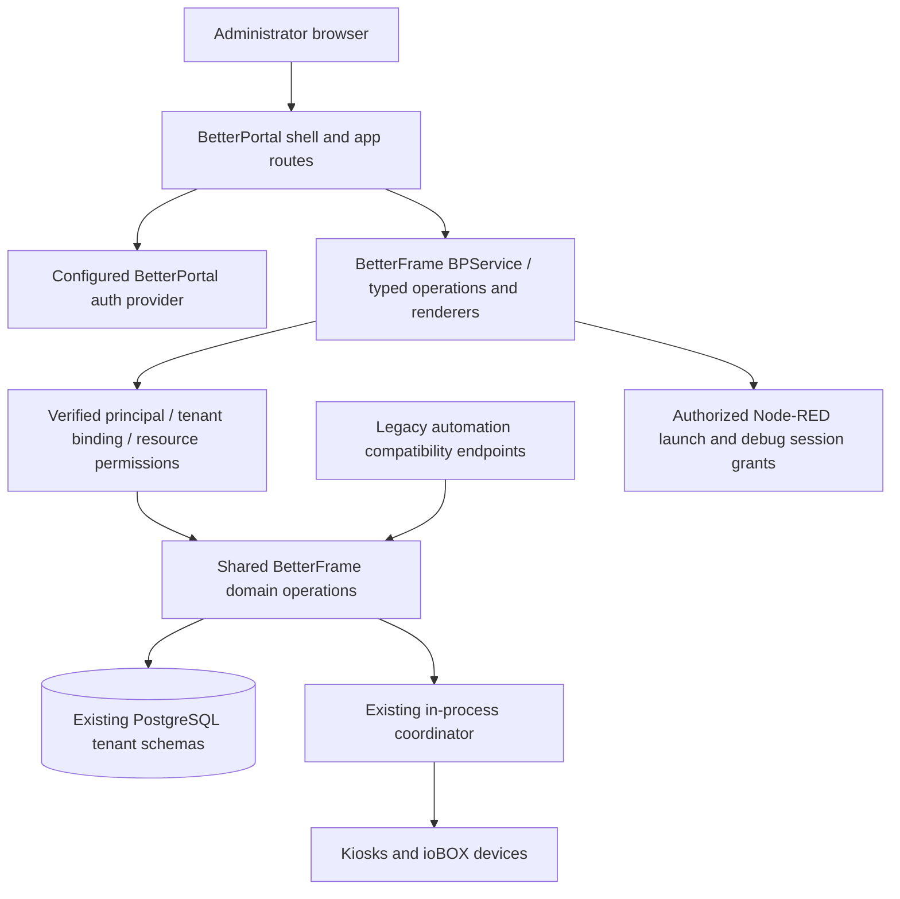

# BetterFrame admin migration to BetterPortal

Status: implementation in progress alongside the legacy frontend. See [implementation and test handoff](betterportal-implementation.md) for verified scope and remaining cutover gates.
Prepared: 2026-09-14. Refreshed: 2026-09-28.

See [current preparation and first implementation gate](betterportal-preparation.md). The baseline table below records the original investigation; use the refresh document for current source pins.

## Outcome and scope

Make BetterFrame an application in BetterPortal. BetterPortal owns the admin shell, navigation, login, account security, and app permissions. BetterFrame supplies typed operations and content renderers for cameras, layouts, displays, kiosks, ioBOX, signage, and operational administration.

Keep the fleet backend, PostgreSQL data, encryption keys, device identities, pairing, updates, and automation contracts working throughout the migration. Complete the transition by retiring BetterFrame's standalone admin pages and human login after parity and recovery have been demonstrated.

This is a native BetterPortal integration. The target is service-owned content inside the BP shell; wrapping the existing full HTML application in an iframe would retain its separate authentication and UI ownership and does not meet the outcome.

## Verified baseline

| Component | Source inspected | Implication |
| --- | --- | --- |
| BetterFrame | Fresh `origin/master`, `59d854d`, fetched 2026-09-14 | Planning branch starts from merged code, not the unrelated branch in the primary checkout. |
| BetterPortal | `7ede8b548e3007e3467de86f7b7d389caeb1c836`, version `10.6.22` | Local checkout matches upstream `master`, checked using `gh api` as `bcbetterninja`. These are planning pins, not a claim of deployed versions or package availability. |
| BetterFrame locked dependencies | BSB `9.6.87`, AnyVali `1.1.0`, h3 `2.0.1-rc.22`, jsx-htmx `2.0.2`, TypeScript `6.0.3` | Establish dependency compatibility before porting screens. |
| BP example service dependencies | Framework/plugin-bsb `10.6.22`, BSB `^9.7.3`, AnyVali `^1.1.6`, jsx-htmx `4.0.100` | Use matching BP packages; test the JSX major upgrade against retained legacy pages. |
| Persistence | PostgreSQL adapter with `withSearchPath`; public and tenant migrations | Some source comments still mention SQLite. PostgreSQL is the current implementation; do not plan a new SQLite migration. |

Worktree: `/home/mitchellr/projects/BetterFrame/betterportal-admin-migration`.
Branch: `plan/betterportal-admin-migration`.

Primary code references:

- [Admin listener and runtime initialization](../server/src/plugins/service-admin-http/index.ts), [auth/tenant middleware](../server/src/plugins/service-admin-http/middleware.ts), [main routes](../server/src/plugins/service-admin-http/routes-admin.ts), [standalone layout](../server/src/web-templates/layout.tsx).
- [Tenant provisioning](../server/src/plugins/service-admin-http/routes-tenants.ts), [database initialization](../server/src/shared/db/init.ts), [platform-admin mirroring](../server/src/shared/db/platform-admin.ts), [audit helper](../server/src/shared/audit.ts).
- [Coordinator registry](../server/src/shared/coordinator-registry.ts), [debug WebSocket authentication](../server/src/plugins/service-coordinator-ws/index.ts), [proxy routing](../deploy/angie/betterframe.docker.conf), [Node-RED callers](../nodered/src).
- [BP service authoring](https://github.com/BetterCorp/BetterPortal/blob/7ede8b548e3007e3467de86f7b7d389caeb1c836/docs/building/services.md), [route authoring](https://github.com/BetterCorp/BetterPortal/blob/7ede8b548e3007e3467de86f7b7d389caeb1c836/docs/building/route-authoring.md), [operations/renderers](https://github.com/BetterCorp/BetterPortal/blob/7ede8b548e3007e3467de86f7b7d389caeb1c836/docs/building/routes-and-views.md), [auth and CORS](https://github.com/BetterCorp/BetterPortal/blob/7ede8b548e3007e3467de86f7b7d389caeb1c836/docs/platform/security-and-auth.md), [shell navigation](https://github.com/BetterCorp/BetterPortal/blob/7ede8b548e3007e3467de86f7b7d389caeb1c836/docs/building/shell-links.md).

The BP routes document contains an older brace-parameter example near its end. Its current route-authoring guide and earlier routing contract specify `:param` mounts and `[param]` source directories; use those and validate with the pinned codegen.

## Target architecture



### Runtime and code ownership

Add `server/src/plugins/service-betterportal-frame/` extending `BPService`, with a separate configurable HTTP listener in the existing BSB process. Proposed runtime plugin identity: `cloud.betterportal.frame`; confirm registration availability during implementation. A registry distribution coordinate is separate from this identity and must be selected in the publishing namespace actually available to BetterCorp.

Keep it in the BetterFrame repository and process initially: `getCoordinator()` is an in-process registry, so an independently deployed UI server could not simply reuse it. A future process split would require an explicit authenticated command/event boundary and is outside this migration.

Extract shared operation logic into intentionally named modules under `server/src/shared/admin/`. Extract the runtime resources now initialized in `service-admin-http/index.ts` into one lifecycle owner. Both HTTP adapters obtain those resources; they must not start duplicate camera health checks, cleanup/purge timers, AbleSign sync, Node-RED reconciliation, or database migrations. Test initialization, failure cleanup, readiness, and shutdown ordering with BP enabled and disabled. BP lifecycle overrides must call/await their base lifecycle.

The BP listener owns discovery, configuration sync, CORS, auth verification, content negotiation, and generated routes. It must not run the legacy cookie/setup middleware or call legacy HTML routes through a shared all-powerful API key. Domain methods receive explicit verified actor, permissions, and tenant context. Retained automation adapters call those same operations with their existing credential contract.

Proposed structure:

```text
server/src/plugins/service-betterportal-frame/
  index.ts                         # BPService, manifest, narrow PluginFeature
  bp-routes/
    overview/{index.ts,GET.ts}
    cameras/{index.ts,GET.ts,POST.ts}
    cameras/[id]/{index.ts,GET.ts,POST.ts}
    cameras/_renderer.bootstrap5/GET.tsx
    ...                            # domains in the parity matrix below
  .bp-generated/                   # generated and ignored
server/src/shared/admin/
  runtime.ts
  principal.ts
  tenant-context.ts
  cameras.ts                       # shared domain operations, not HTTP handlers
  ...
server/betterportal.json            # service project/contract configuration
```

The `bootstrap5` renderer suffix is the proposed first target for the existing Bootstrap1 shell; verify the chosen app's `shell.renderer` before writing renderers. BP shell identity and renderer identity are different concepts.

### BP ownership and local tenant provisioning

Decision confirmed by the user on 2026-11-04: BP owns tenant creation and management, users, authentication, roles, membership, and permissions. The BP client handles tenant selection. Frame uses the verified BP tenant ID to find or initialize local Frame resources. Frame does not offer a separate tenant creation flow, user directory, membership editor, or human permission store.

Use the auth provider already bound to the destination BP app. The BP framework verifies identity, app context, and operation permissions before any Frame tenant lookup or initialization. Login, logout, password recovery, MFA, account security, invitations, and user/permission management belong to BP and its provider. Frame declares method-specific permissions in its service contract; BP administrators assign them and Frame endpoints enforce them through BP verification.

Local provisioning follows this sequence:

1. Resolve and authorize the request through BP. A tenant ID supplied in an arbitrary header, query, cookie, or Origin is not sufficient. The tenant must be valid and active in verified BP context and the caller must be permitted to use the Frame operation.
2. Look up the local provisioning record by BP tenant ID within the configured trusted BP installation. App ID remains part of BP authorization context; another authorized app in the same BP tenant must not create a second Frame data tenant.
3. If local resources are ready, reuse them without repeating setup. For an existing Frame installation, resolve an explicit migration mapping to the existing Frame tenant/schema; never adopt data by matching a name, slug, or email.
4. If the local record is absent, automatically initialize only Frame-owned resources: the local tenant record/schema, migrations, defaults, and required per-tenant integrations. This does not create a BP tenant or assign users or permissions. Protect initialization with a database uniqueness constraint and a cross-process lock so simultaneous first requests share one result.
5. Mark provisioning ready only after required setup succeeds. Failed or incomplete setup is retryable and cannot serve partial tenant data. Suspended, revoked, or archived resources cannot be silently recreated by the missing-record path.
6. Run the operation inside the resolved local tenant scope and retain resource-ownership checks. Never fall back to the default/public tenant on a lookup or provisioning failure.

Introduce additive local records in the public schema:

| Proposed record | Purpose and constraints |
| --- | --- |
| `bp_tenant_bindings` | Unique trusted BP installation/tenant identity to one local Frame tenant UUID, with provisioning state and lifecycle status. BP installation scope is a configured trust boundary, not a browser-supplied URL. Schema names come from local records. |
| Provisioning progress | Idempotent setup/retry state for local resources and integrations; records completion without becoming a second tenant authority. Keep deactivation/archive tombstones so first-use setup cannot resurrect them. |
| Audit identity references | Verified BP issuer/subject and tenant/app identifiers, plus optional explicit historical Frame actor links needed by existing references. These records provide attribution only and grant no membership, role, or access. |

There is no parallel Frame membership or permission assignment table for BP users. Existing operator/administrator capabilities become BP-managed operation grants; shared release or other installation-wide operations also require explicit BP grants. BP's reserved `*` role must not be treated as automatic Frame platform authority. The normal BP tenant context selects the local scope; any cross-tenant administration requires an explicit supported BP authorization contract, never a Frame cookie switch or a local superuser bypass.

Keep database, command routing, Node-RED, files, caches, and background work scoped to the mapped local tenant. Test concurrent requests across tenants and within first-use provisioning. BP supplies identity and authorization; Frame still enforces data/resource scope and device capability restrictions. Preserve Android restrictions on power, GPIO, debug, and managed configuration.

Account transition happens on the BP side. Inventory existing identities and role requirements for an explicit migration/invitation procedure without exporting password hashes, TOTP secrets, recovery codes, or sessions. Retain legacy auth records only for the rollback window; do not manufacture local password accounts or mirror BP role assignments into Frame. Existing audit and uploader references may retain explicit historical identity links without using them for authorization.

Audit Frame operations with the verified BP principal, tenant/app, local tenant, resource, action, and result without storing tokens. Auth-provider audit and Frame domain audit serve different purposes and both remain available. Existing machine API/device credential contracts remain separate compatibility boundaries during migration; first-use human provisioning does not change their grants or identities.

### Operations and renderers

Each method file owns its stable `operationId`, schemas, auth, permissions, dependencies, and typed handler. Its `index.ts` owns stable `viewId` and parameter metadata. Use concrete AnyVali schemas throughout and generated `createHandler`; never export raw repository rows containing encrypted credentials, password fields, keys, or unnecessary internal state.

Model each user capability as one operation contract with negotiated JSON and HTML rendering where appropriate. BP app configuration owns page paths, menu grouping, and chrome; mutation/fragment/raw operations receive API mounts and explicit dependencies. Generated route metadata and contract output are generated by BP hooks, not hand-maintained.

Port page content from `admin-pages.tsx` into method-specific renderers. Remove the legacy full document, sidebar, topbar, bundled HTMX, and global CSS from BP responses. Use shell styling and small shared controls. Retain required per-page behavior such as local time formatting, layout interactions, polling, file uploads, and validation, but give scripts cleanup on navigation so swaps cannot accumulate listeners, polling timers, or sockets.

Use BP URL helpers for navigation and forms. Parameterized/ambiguous mounts require `ctx.url.uiRoute`; do not hardcode `/admin/...`, shell origins, or `location.host` as the service host. Include mounted operation dependencies for fragments and actions. Keep browser-visible URL state in the renderer/app layer. Test validation errors and successes in both HTML and JSON representations; service fragments must target their own content, not the shell.

Authenticated images, snapshots, file downloads, and browser WebSockets need explicit transport: plain ``, download navigation, and `new WebSocket()` do not automatically carry BP bearer headers. Prefer shell-managed authenticated fetch plus blob URLs for finite media/downloads, with cleanup, or bounded single-use capabilities when streaming requires them. Never put a BP bearer or reusable admin key in a URL. Preserve raw content types, limits, and streaming behavior for snapshot/proxy/upload operations.

## Feature parity and compatibility

The companion [route inventory](betterportal-admin-route-inventory.csv) records HTTP method, existing path, source location, proposed disposition, and migration wave. It covers explicit admin-listener registrations and the two known route loops. It is a static planning inventory, not runtime proof; re-enumerate routes and callers before implementation and reconcile new upstream changes.

| Surface | Migration deliverable | Gate |
| --- | --- | --- |
| Overview, health, audit, settings | BP pages and typed read models; preserve filters/time display and update schedule controls | Counts/status and tenant scope match existing behavior. |
| Cameras and camera devices | CRUD, labels, discovery, discovered snapshots, device sync, event refresh/subscriptions, ONVIF operations | Credentials stay server-side; discovery tokens and snapshot ownership remain enforced. |
| Entities and layouts | CRUD, snapshots, dashboard sync, layout cells/move/resize/delete, quick layouts, device layouts, clone/priority | Layout edits persist correctly and notify affected kiosks once. |
| Displays and kiosks | Pairing, assignment, layouts, power/volume, labels, logs, managed configuration, Windows policy, local-key rotation, reboot, Tailscale, operator-console enrollment/stations | Preserve command validation, supported-device controls, offline behavior, and audit. |
| ioBOX | Models, serial provisioning, devices, mappings, firmware selection/import | Existing device identity and pairing remain valid. |
| Firmware and OS updates | Upload/import, yank, per-device target/push, rollout list/create/state | Signed artifact checks, targets/channels, staged rollouts, and CI contract remain intact. |
| Cloud and AbleSign | Account connections/sync/delete, screens, groups/members, content/media/folders/websites, playlist actions and polling | All registered actions migrate, including routes absent from sidebar navigation. |
| Tenants | BP owns tenant creation/selection/lifecycle; Frame automatically ensures local resources for a verified BP tenant | Concurrent first use initializes once; existing data maps explicitly; archive/revocation cannot trigger recreation; no Frame tenant CRUD UI. |
| Account and setup | BP auth/account links; protected installation/provisioning workflow for BF cluster state | Fresh install and existing install both work without a second permanent login system. |
| Backup | BP page describing/supporting the existing stack backup workflow | Preserve PostgreSQL/volumes/key recovery; retired SQLite download/restore POSTs stay rejected with 409. |
| Node-RED editor | BP launch page and narrowly authorized editor access | Editor HTTP, assets, WebSocket/comms, tenant selection, expiry, and logout/revocation work without legacy BF human login. |
| Remote logs/terminal | BP views and an explicit authenticated coordinator session handshake | MFA/elevation, target tenant/device, dev-channel policy, terminal challenge, expiry/replay and disconnect tested. |

### Endpoints that survive removal of standalone pages

- `/api/admin/*` is consumed by Node-RED and scripts; `/api/admin/firmware/import`, `/api/admin/iobox/firmware/import`, and `/api/admin/os/import` also serve CI. Preserve method, payload, response, key validation, and tenant semantics during migration.
- Node-RED also calls `/admin/displays/:displayId/layout/:layoutId`, `/admin/kiosks/:id/power/{standby,wake}`, and `/admin/entities/:id/snapshot`. Preserve these as explicit compatibility operations even when page routes are retired. Audit other external consumers before deleting any route.
- `/api/displays/:id/{focus,clear,restore}` stays a protocol contract; verify both its direct server consumers and proxy exposure rather than assuming `/api/*` is forwarded (the proxy has a catch-all 404).
- Device paths `/api/pair/*`, `/api/kiosk/*`, `/api/iobox/*`, `/ws/kiosk`, public firmware/OS paths, `/dash/*`, `/in/*`, `/oce/*`, health and version retain existing routing/authentication. Keep the canonical device origin `https://frame.betterportal.net` directly served.
- Use an explicit method/path compatibility allowlist. A blanket `/admin/*` redirect would break POSTs, snapshots, and debug routing. Redirect only known human page GETs once their BP page mapping exists; raw/fragment GETs require individual dispositions.

### Two required integration spikes

**Node-RED:** its editor is under `/nrdp/`, currently guarded by Angie's `/api/admin/_check`, which requires a legacy authenticated admin. Adopt an isolated editor session bridge: a BP-authorized operation creates a short-lived, one-use launch grant tied to principal, app, tenant, and editor purpose; a separate non-BP launch endpoint redeems it and sets a narrowly scoped, HttpOnly/Secure editor cookie. Validate that cookie at the editor gate for HTTP and WebSocket upgrades, strip client-supplied identity headers, and pass only the verified tenant to the manager. Protect unsafe cookie-authenticated editor requests, bound session lifetime, and define revocation/logout behavior. BP APIs themselves remain cookie-free. Grant storage/redemption must support the deployed process topology and consume atomically; do not create a generic BF admin session. This is a proposed bridge, not an existing capability. Failure to prove it blocks legacy login retirement.

**Debug:** replace the admin WebSocket's dependency on BF sessions/reusable URL API keys for BP users with an expiring, single-use grant issued only after BP authorization and required MFA/elevation. Bind it to principal, target tenant, kiosk, allowed journal/terminal purpose, and app origin; coordinator consumes it atomically before subscription. Require elevated authorization for terminal separately from logs, expire/close access, prevent replay, and retain kiosk-side terminal challenge plus device/channel restrictions. Do not pass browser-selected tenants directly to the coordinator. Confirm the chosen BP provider supplies a verifiable elevation result; if it cannot, remote debug remains disabled in BP until resolved. Existing explicitly authorized machine debug access can remain a separate compatibility path.

## Implementation sequence

Each wave should be a reviewable change with the stated gate. Refresh against then-current `master` before implementation; the primary checkout already has additional work on another branch.

| Wave | Concrete change | Required completion evidence |
| --- | --- | --- |
| 0 — contracts and integration spikes | Refresh route/caller inventory; inspect destination BP app/provider/renderer and origins; finalize tenant/permission mapping; prove Node-RED bridge, debug elevation/grants, authenticated media; confirm package availability and deployment topology | Written decisions and small working end-to-end proofs. No deployment cutover based on assumptions. |
| 1 — dependency upgrade | Add matching framework/plugin-bsb, upgrade BSB/AnyVali and JSX as needed, retain current build/static hooks, add BP gen/types/contract hooks and route ignores | Clean lockfile install, server build/tests, and browser smoke of existing pages. Separate JSX compatibility repairs from screen migration. |
| 2 — shared runtime and BP foundation | Extract single runtime/domain ownership; add BP plugin, manifest, config, typed operations, additive mappings, audit adapter, provisioning dry-run; first BP overview read | Real shell login → overview; anonymous, wrong tenant/app, wrong issuer/audience, and unauthorized resource denied; legacy runtime still works. |
| 3 — core fleet administration | Cameras/devices, entities, layouts, displays, kiosks, ioBOX; migrate all actions/fragments and capability checks | Administrator/operator parity; persisted changes reach correct devices; media works through distinct shell/service origins. |
| 4 — remaining administration | Cloud/AbleSign, firmware/OS rollouts, settings/audit/backup, BP-driven local tenant lifecycle, provider-owned account links, fresh-install provisioning | Uploads/signatures/CI, local archival, BP account recovery, and complete inventory parity; no Frame tenant/user/permission creation UI. |
| 5 — browser protocol integrations | Production implementation of Node-RED editor bridge and coordinator debug grants; remove those flows' dependency on BF human sessions | Real editor assets/comms, MFA/elevation, terminal challenge, expiry/replay/logout, origin checks and tenant isolation demonstrated. |
| 6 — canary and cutover | Install/register service, mount pages and operation dependencies, assign explicit BP grants, link accounts, enable a test tenant then wider rollout, add page GET redirects | Full acceptance suite, backup/restore drill, account access confirmed, before/after fleet/automation health, demonstrated config rollback. |
| 7 — retire duplicate UI | Disable legacy human auth/setup for migrated installations, remove standalone templates/assets only after caller audit, retain documented machine compatibility endpoints and device auth | No normal admin workflow needs BF login or shell; all inventory entries have a tested destination/retention reason. Delete old auth data only in a later separately reviewed retention cleanup. |

Wave 2's first slice is deliberately small: authenticated overview GET as typed JSON and shell-rendered HTML, resolving a verified BP tenant through an existing migration mapping or automatic first-use local provisioning. It must prove generated discovery/contract, app mounting, permissions, redaction, readiness, and legacy coexistence before broader page work.

## Installation, upgrade, and rollback

Support both connecting to an existing hosted BP installation and a documented self-hosted BP shell/auth/config setup for self-hosted BetterFrame. Destination app ID/hostname, provider, renderer, allowed origins, and service origin are deployment inputs; this plan does not invent new DNS records or change `frame.betterportal.net`.

Add example configuration and compose/proxy documentation for the BP listener plus protected persistent BP installation state (service keys, bootstrap state, snapshots). Keep Frame domain credentials and existing encryption material in their current store; moving all secrets into BP is a separate data migration. Back up new BP state as well as the existing database, BF data/key material, and Node-RED volumes. Distinguish BP readiness from fleet readiness so a BP outage cannot fail device health or force kiosk traffic into a login redirect.

Separate installation-wide Frame bootstrap from per-tenant resource provisioning. BP creates tenants and manages users and grants; Frame never initiates BP tenant creation. Existing installations must not regenerate cluster keys or rerun installation setup merely because BP is enabled. Initialize installation-wide resources through a protected operator/bootstrap procedure. Thereafter, authorized first use of a verified BP tenant automatically ensures local resources with idempotent steps, explicit provisioning/ready/failed states, retries, and a repair report. Existing Frame tenant data requires an explicit migration mapping. Define how BP lifecycle changes reach Frame, the revocation propagation window, and safe local archival/retention; BP deletion must not immediately drop operational schemas or device data. A locally recorded suspension or revocation denies access regardless of stale BP snapshots and must not be undone by automatic setup.

Upgrade runbook:

1. Capture current server/proxy images/config, route mounts, role grants, mappings, and backup inventory; perform a restore drill on isolated storage. Do not export credential values into reports.
2. Apply additive BF migrations and provision BP installation state. Run mapping/account dry-run and resolve missing/duplicate identities and inactive tenants.
3. Deploy the BP-capable server with legacy routes intact and BP routing opt-in. Register/install its service, sync manifest/contract, mount GET pages and required API dependencies, and grant only intended access. Publishing/installing a service is distinct from granting it permissions.
4. Canary with representative administrator and operator accounts on a test tenant. Exercise negative tenant/role cases, Node-RED, debug, files, fleet actions, and expiry. Confirm recovery account access before changing login entry points.
5. Enable BP entry points for successive tenant/app bindings. Redirect known human GET pages only. Keep machine APIs and fleet origins stable; record failures, denied accesses, device connectivity, command delivery, and automation results against the pre-upgrade baseline.
6. After a complete operating cycle including account recovery, update/rollout, and scheduled automation, remove the legacy human surface only when parity evidence is complete. A fixed elapsed time alone is not a retirement gate.

Rollback before retirement: disable BP page routing/redirects, restore previous proxy/app config, and use the retained BF login in a compatible BP-capable server image. Older binaries cannot decode newly encrypted `bf-camera:` credentials; do not restore such an image over these writes. All domain writes already use existing schemas; additive mappings may remain unused. Keep prior identity assignments usable during the rollback window and reconcile any BP-era account/role changes before re-enabling old login so revoked users do not regain access. Do not restore the entire old database over newer operational writes as a routine rollback.

Rollback after legacy code removal requires redeploying the retained compatible server image and restoring its access configuration. Destructive removal of old authentication data is deferred precisely because it would remove that recovery path. Loss of BP should make the admin UI unavailable while device serving/automation continue; never automatically fall back to a weaker identity check.

## Validation and completion criteria

Planning validation is a route/source inventory and review of both repositories; no runtime migration has been tested by this document.

Implementation must run the existing `npm ci`, `npm run build`, and `npm test` flow, BP codegen/contract validation, and applicable PostgreSQL integration tests. Preserve the existing security-boundaries, tenant-auth, auth-session, pairing, coordinator-websocket, admin-power-routes, Android viewer/capability, firmware, Node-RED, backup, and local-time coverage. PostgreSQL tests that skip without a database must run against a disposable database for the migration gate; a skipped test is not evidence.

Add focused integration tests for the new boundaries:

- Real BP shell with distinct app/service origins: login/refresh/logout, CORS preflight, deep links, parameter encoding, Back/Forward, validation errors, dependency mounts, and renderer matching.
- Cross-tenant concurrency and resource guessing; verified first-use tenant setup initializes exactly once under concurrent requests and retries after partial failure; unverified/inactive tenants and revoked/archived mappings cannot provision; spoofed context headers, invalid JWT issuer/audience, insufficient BP permissions, and service identities without approved grants are denied.
- Upgrade fixtures with multiple BF tenants, existing users/API keys/device identities, release metadata, and audit references; idempotent mapping/provisioning and pre-/post-upgrade rollback.
- Credential redaction in negotiated JSON, HTML, manifests, logs, audit, and error responses; authenticated raw snapshots/downloads and multipart uploads.
- Side-effect parity: command delivered once to the right device, correct unsupported-device controls, updates preserve signing/target checks, Node-RED callers keep their payloads and tenant headers.
- Node-RED and debug grant expiry, atomic one-time use, cross-tenant/device substitution, logout/revocation, WebSocket close, denied elevation, and required terminal challenge.
- BP unavailable at startup and at runtime: fleet APIs, pairing, dashboards, updates, and automation remain healthy; lifecycle work does not duplicate.

Completion means every retained admin capability is usable through BP with appropriate permissions, all inventory rows have a disposition and test evidence, BF human login/navigation is retired, and documented rollback still works. The device viewer UI and third-party Node-RED editor are separate product surfaces, not replacement targets for BP renderers.

## Decisions to settle during wave 0

These do not block preparing this plan, but their dependent implementation cannot be finalized from repository inspection alone:

| Decision | Working proposal | Evidence needed |
| --- | --- | --- |
| Destination BP app, host and provider | Reuse an existing BP app/provider binding; BP hosts the admin entry point | Inspect live app/service config and identify installation owner; no auth config changes are authorized by this planning task. |
| Tenant relationship (ownership settled 2026-11-04) | BP tenant authority; one local resource scope per trusted BP tenant; automatic ensure-on-first-use; users/auth/permissions exclusively BP-managed | Verify BP client/context contract, current Frame migration mappings, provisioning lock/retries, and lifecycle/revocation propagation. |
| Shell/renderer | Existing Bootstrap1 shell with `bootstrap5` content renderers | Actual destination `app.shell.renderer` and UX smoke. |
| BP account transition and MFA | BP owns users, membership and grants; optional Frame historical links are attribution only; preserve or strengthen debug MFA | Provider capabilities, current user identifiers, BP migration/recovery procedure; no duplicate Frame authorization store. |
| Editor/debug bridges | Isolated editor cookie outside BP APIs; bounded coordinator grants | Working spike under production-like proxy and process topology. |
| Self-hosted packaging | Document a local BP deployment option alongside hosted registration | Supported installation topology, persistent volumes, auth/config bootstrap and recovery tested. |
| Registry coordinates and deployment | `cloud.betterportal.frame` runtime identity; registry coordinate chosen separately | Registry namespace access and matching package/release availability at implementation time. |

No PR, package publication, production configuration update, or deployment is included in this planning change.
